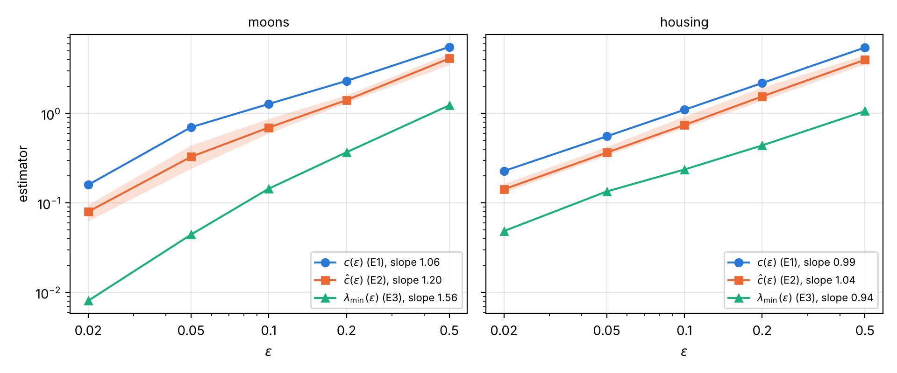

# Numerical verification of stability and local Polyak–Łojasiewicz inequalities for entropic mean-field Neural ODEs

[](https://www.python.org/)
[](LICENSE)
[](https://github.com/dantor03/mfnode-pl-verification/actions/workflows/ci.yml)

Preprint and code by **Daniel Torres González** (ICMAT–CSIC, JAE Intro fellowship).

📄 **Preprint (draft):** [`paper/main.pdf`](paper/main.pdf)

The preprint is a numerical companion to

> S. Daudin, F. Delarue, *Genericity of Polyak–Łojasiewicz inequalities for
> entropic mean-field Neural ODEs*, [arXiv:2507.08486](https://arxiv.org/abs/2507.08486) (2025).

It computes the optimal control ν\* of the entropic mean-field control problem
behind continuum-depth ResNets and tests the two results of that paper:

- **Stability and uniqueness** (Meta-Theorem 1.3): independence of the fixed
  point from the initialization, smallest Hessian eigenvalue λ_min(ε) > 0,
  genericity across perturbed data, and the Jacobi condition.
- **Local PL inequality and the conjectured exponential convergence**
  (Meta-Theorem 1.4): the empirical PL constant c(ε), the descent rate ĉ(ε),
  and λ_min(ε), three independent estimators of the degeneration as ε → 0⁺.

## Key results



- **Stability.** The fixed point ν\* is reached from initializations far from it, and the
  projected Hessian stays positive definite along the whole ε-schedule on both benchmarks
  (λ_min = 0.0081 on moons and 0.048 on housing at ε = 0.02). The Jacobi condition holds:
  the problem restarted from an intermediate layer recovers the restriction of ν\*.
- **Genericity.** On twelve perturbed data sets (resampled and noisier moons, housing
  subsamples) the minimizer stays stable and the empirical PL constant varies by less than 2%.
- **PL inequality.** Every sampled perturbation satisfies it, and the Wasserstein gradient
  descent converges exponentially with a rate that does not depend on the initial direction.
- **Degeneration as ε → 0⁺.** Three independent estimators show that the PL constant decays
  essentially linearly in ε. On the classification task (moons) c(ε) ∝ ε^1.06 and
  ĉ(ε) ∝ ε^1.20, with a super-linear steepening at the smallest ε, where ν\* concentrates; on
  the regression task (housing) c(ε) ∝ ε^0.99, ĉ(ε) ∝ ε^1.04 and λ_min(ε) ∝ ε^0.94, with no
  steepening.
- The loss of convergence of the fixed-point iteration at small ε is a period-doubling of
  the damped map, not a loss of stability of ν\*.

Open points, stated in the preprint:

- The levels of the estimators depend on the grid (the same perturbation cloud gives a c
  about twice as large on the asymmetric grid as on the pilot grid); only the exponents
  are compared across grids.
- At ε = 0.02 the relative entropy to ν\* decays with a slow tail of small amplitude that
  the cost does not show.
- On moons the region where the cost is quadratic around ν\* shrinks by more than a factor
  of four between ε = 0.05 and ε = 0.02.

Status: **complete draft**, pending review before submission; see
[`ROADMAP.md`](ROADMAP.md).

## Layout

```
paper/            preprint (main.tex, references.bib, figures/, main.pdf)
src/plnode/       library
  solver.py          explicit Gibbs solver: damped fixed point + ε-continuation,
                     backward equation by the Jacobian cocycle
  fisher.py          discretized Fisher functional 𝓘_h (compatible assembly)
  gradient_flow.py   Scharfetter–Gummel Wasserstein gradient flow
  hessian.py         matrix-free projected Hessian, LOBPCG λ_min
  perturbations.py   perturbation clouds around ν*
  datasets.py        frozen benchmarks (moons / California Housing top-2)
experiments/      runners (00–03 solver & gates, 10–12 uniqueness/continuation/
                  concentration, 13 genericity, 14 Jacobi condition,
                  15 grid dependence of c, 16 quadratic regime,
                  e1–e4 PL experiments, fig_star, fig_e2_entropy, fig_optimum)
results/          frozen ν* checkpoints (nu_star/), experiment outputs, logs
tests/            correctness suite (pytest)
```

## Reproduce

```bash
pip install -e ".[dev]"
pytest tests/                                   # ~1 min
python experiments/00_compute_nu_star.py --all  # or use the frozen checkpoints
python experiments/e1_pl_constant.py --problem moons --grid asym
python experiments/e2_descent.py --problem moons --eps 0.05 --n-steps 600
python experiments/e3_hessian.py --problem moons --grid pilot --all-eps
python experiments/fig_star.py --grid asym
cd paper && latexmk -pdf main.tex
```

Everything runs on a laptop CPU (numpy/scipy); timings are listed in the
paper's reproducibility appendix.

## License

MIT (code). The preprint text and figures are © the author.
